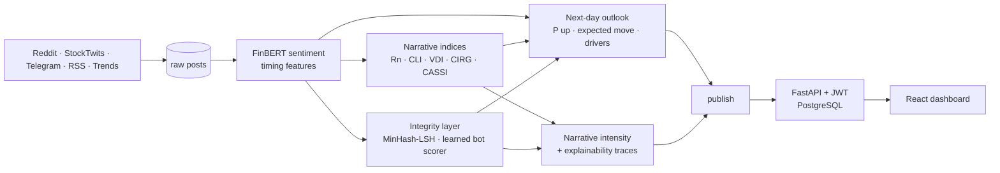

# Diverge: financial narrative intelligence

[](https://github.com/GeoJeffrey/diverge/actions/workflows/ci.yml)
   

**Diverge reads public sentiment about a stock and estimates what happens next: whether it is more likely to close up or down tomorrow, and whether to expect a bigger move than usual. Every estimate comes with the reasons behind it and the model's measured track record.**

It collects posts from Reddit, StockTwits, Telegram, financial news RSS and Google Trends. It scores them with a FinBERT model fine-tuned on finance tweets. It then turns them into daily signals: sentiment shifts, attention spikes, bull/bear disagreement, and an epidemiological *reproduction number* for how fast a story is recruiting new posters. An integrity layer flags bot-like coordinated campaigns and pulls the estimate toward 50/50 when the conversation looks inorganic. Everything is served through a JWT-secured FastAPI backend and a React dashboard. Every model is checked by a reproducible, walk-forward evaluation suite.

> **Honest framing.** Next-day *direction* is close to a coin flip for liquid stocks, and Diverge shows exactly how close next to every call. Social attention is much better at predicting *how much* a stock will move, and that is where most of the signal is.

---

## Results

Every number below is reproduced by `python -m diverge.evaluation.run_all`. The full tables are in **[reports/RESULTS.md](reports/RESULTS.md)**.

**Coordinated-campaign detection**: 4,000 simulated 2-hour windows / 491k posts. Half contain an injected bot campaign (5-50% of traffic, paraphrased promo templates, scheduled posting with jitter). The negatives include organic news bursts with shared headline text.

| Scorer | ROC-AUC | Precision | Recall | F1 |
|---|---|---|---|---|
| Original hand-weighted score | 0.657 | 1.000 | 0.005 | 0.010 |
| **Learned scorer (now in the pipeline)** | **0.960** | **0.930** | **0.912** | **0.921** |

- **MinHash + LSH near-duplicate search** (written from scratch, no dependency): **42× faster** than exhaustive comparison on 4,000 posts, with 100% pair recall.
- The ablation shows that cross-account near-duplicate text carries almost all of the detection signal. The timing tests (KS vs Poisson, ACF) added nothing measurable.
- Main failure mode: 17% false positives on organic news bursts. See [limitations](docs/architecture.md#known-limitations).

**Sentiment model** (held-out finance tweets), **predictive backtest** (~1.7M tweets, 2015-2019, walk-forward against a price-only baseline) and the **next-day outlook's track record**: run `python -m diverge.evaluation.run_all` on a GPU machine. The results are written to `reports/RESULTS.md` and shown in the dashboard's *Model accuracy* page.

---

## What's inside



| Signal | What it measures | How |
|---|---|---|
| **Next-day outlook** | P(next close is higher) and expected move vs normal, with the top drivers | Logistic + ridge models on daily social and price features, trained walk-forward; per-feature contributions shown in the UI |
| **Rn**, contagion | Is the story recruiting new posters faster than it loses them? | Renewal-equation estimator (Cori et al. 2013) on first-mention onsets, with a 95% credible interval |
| **CLI**, capitulation | Share of "I'm out, sold everything" posts | Lexicon classifier |
| **VDI**, language divergence | English vs Hinglish sentiment gap | Pooled z-scores |
| **CIRG**, reality check | Investor hype vs consumer reviews | Pooled z-scores |
| **CASSI**, spillover | How much one stock's sentiment is driven by others | VAR forecast-error variance decomposition |
| **Coordination** | Probability that the window contains a coordinated campaign | Logistic model on duplicate, timing and variance features |

Every index returns a real value or `null` with a coverage note. No placeholder values are filled in.

Full methodology, evaluation design and limitations: **[docs/architecture.md](docs/architecture.md)**.

## Tech stack

Python · PyTorch · Hugging Face Transformers · scikit-learn · statsmodels · pandas · FastAPI · SQLAlchemy · Alembic · PostgreSQL · JWT/bcrypt · APScheduler · React 19 · TypeScript · Vite · Tailwind · Recharts · Docker · GitHub Actions · Railway · Vercel

## Quick start

```bash
git clone https://github.com/GeoJeffrey/diverge.git && cd diverge
python -m venv .venv && source .venv/bin/activate     # Windows: .venv\Scripts\activate
pip install -r requirements.txt && pip install -e .

python run_all.py                 # scrape → features → indices → integrity → composite → outlook
python run_server.py --port 8000  # API on http://localhost:8000/docs
cd frontend && npm install && npm run dev               # dashboard on http://localhost:5173
```

Or run everything in containers: `docker compose up --build`. Without `DATABASE_URL`, the app uses a local SQLite file.

## Reproduce the evaluation

```bash
pip install -r requirements-eval.txt
python -m diverge.evaluation.run_all            # full run, ~1 h on a laptop GPU
python -m diverge.evaluation.run_all --quick    # CPU smoke run, ~10 min

# API latency (with the server running in another terminal)
python scripts/bench_api.py --requests 2000 --concurrency 32
python -m diverge.evaluation.run_all --render   # adds the latency table to RESULTS.md
```

| Step | Module | Data |
|---|---|---|
| Bot-campaign detection | `evaluation/coordination_benchmark.py` | Simulated, with ground truth (offline) |
| FinBERT fine-tuning | `evaluation/finetune_sentiment.py` | `zeroshot/twitter-financial-news-sentiment` train |
| Sentiment benchmark | `evaluation/sentiment_benchmark.py` | Same dataset, held-out validation split |
| Predictive backtest | `evaluation/backtest.py` | `mjw/stock_market_tweets` + Yahoo Finance; or `--source db` for your own scraped data |
| Outlook model + track record | `evaluation/train_outlook.py` | Same data; writes `src/diverge/outlook/outlook_model.json` |

## API

| Method | Endpoint | Auth |
|---|---|:-:|
| `GET` | `/health` | |
| `GET` | `/tickers`: monitored tickers with composite score and trust badge | |
| `GET` | `/ticker/{symbol}/simple`: plain-language summary card | |
| `GET` | `/ticker/{symbol}/outlook`: next-day outlook with drivers | |
| `GET` | `/outlook`: latest outlook for every ticker | |
| `GET` | `/outlook/model`: model card and walk-forward track record | |
| `POST` | `/auth/signup`, `/auth/login`, `/auth/refresh` | |
| `GET` | `/auth/me` | ✓ |
| `GET` | `/ticker/{symbol}`: all indices, coordination score, risk flags | ✓ |
| `GET` | `/ticker/{symbol}/reasoning`: post-level reasoning traces | ✓ |

The contract is frozen in [`docs/openapi.json`](docs/openapi.json); `scripts/diff_openapi.py` detects drift.

## Tests

```bash
pytest -q     # 83 tests: index maths, Rn recovery, LSH vs brute force, backtest leakage checks, outlook train/serve parity, API
```

CI runs a secret scan, the test suite, an offline benchmark smoke test and the frontend build on every push.

## Project layout

```
src/diverge/
  scrapers/        ingest (Reddit, StockTwits, Telegram, RSS, Trends, reviews)
  features/        sentiment, capitulation, sarcasm, language, timing/periodicity
  indices/         Rn, CLI, VDI, CIRG, CASSI
  integrity/       MinHash-LSH, coordination scorer (+ learned weights)
  outlook/         shared daily features, next-day outlook model + live phase
  aggregation/     narrative intensity score
  explainability/  reasoning traces, narrative phylogeny
  evaluation/      benchmarks, backtest, outlook training, report generator
  pipeline.py      one end-to-end pipeline for the CLI and the scheduled worker
  publish.py       pushes results from the worker's store to the API's database
  api/ db/ auth/   FastAPI app, SQLAlchemy models, JWT
frontend/          React + Vite dashboard
reports/           generated results (RESULTS.md + JSON)
```

## License

MIT
