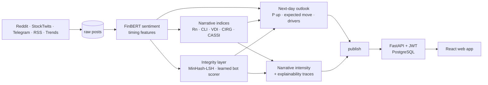
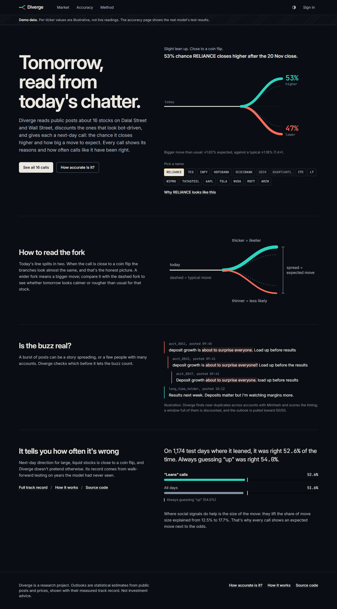
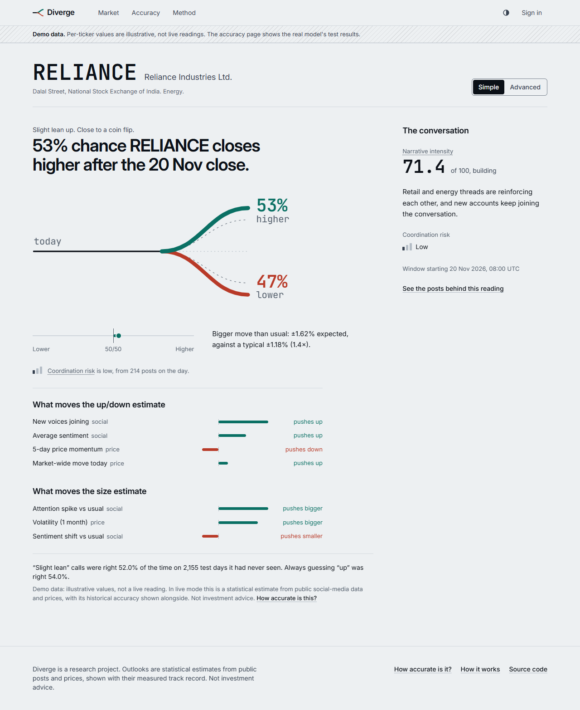
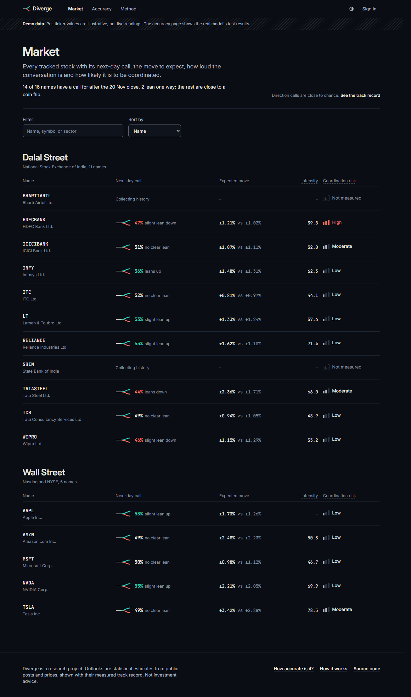
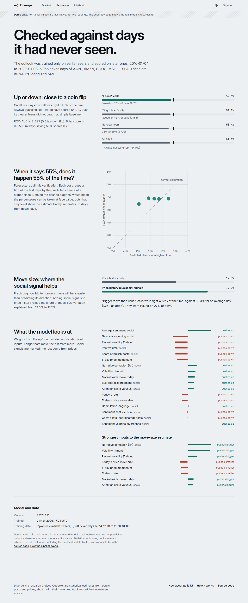

# Diverge: financial narrative intelligence

[](https://github.com/GeoJeffrey/diverge/actions/workflows/ci.yml)
   

**Diverge reads public sentiment about a stock and estimates what happens next: whether it is more likely to close up or down tomorrow, and whether to expect a bigger move than usual. Every estimate comes with the reasons behind it and the model's measured track record.**

It collects posts from Reddit, StockTwits, Telegram, financial news RSS and Google Trends. It scores them with a FinBERT model fine-tuned on finance tweets. It then turns them into daily signals: sentiment shifts, attention spikes, bull/bear disagreement, and an epidemiological *reproduction number* for how fast a story is recruiting new posters. An integrity layer flags bot-like coordinated campaigns and pulls the estimate toward 50/50 when the conversation looks inorganic. Everything is served through a JWT-secured FastAPI backend and a React web app. Every model is checked by a reproducible, walk-forward evaluation suite.

> **Honest framing.** Next-day *direction* is close to a coin flip for liquid stocks, and Diverge shows exactly how close next to every call. Social attention is much better at predicting *how much* a stock will move, and that is where most of the signal is.

---

## Results

Every number below is reproduced by `python -m diverge.evaluation.run_all`. The full tables are in **[reports/RESULTS.md](reports/RESULTS.md)**.

**Coordinated-campaign detection**: 4,000 simulated 2-hour windows / 491k posts. Half contain an injected bot campaign (5-50% of traffic, paraphrased promo templates, scheduled posting with jitter). The negatives include organic news bursts with shared headline text.

| Scorer | ROC-AUC | Precision | Recall | F1 |
|---|---|---|---|---|
| Original hand-weighted score | 0.657 | 1.000 | 0.005 | 0.010 |
| **Learned scorer (now in the pipeline)** | **0.960** | **0.930** | **0.912** | **0.921** |

- **MinHash + LSH near-duplicate search** (written from scratch, no dependency): **40× faster** than exhaustive comparison on 4,000 posts (15.7 s → 0.39 s), with 100% pair recall.
- The ablation shows that cross-account near-duplicate text carries almost all of the detection signal. The timing tests (KS vs Poisson, ACF) added nothing measurable.
- Main failure mode: 17% false positives on organic news bursts. See [limitations](docs/architecture.md#known-limitations).

**Sentiment model**: `zeroshot/twitter-financial-news-sentiment`, official validation split as the test set (2,388 finance tweets; trained on 9,543).

| Model | Accuracy | Macro-F1 | Texts/sec |
|---|---|---|---|
| Keyword lexicon (baseline) | 0.675 | 0.438 | 78,284 |
| TF-IDF + logistic regression | 0.827 | 0.771 | 60,006 |
| FinBERT zero-shot (ProsusAI/finbert) | 0.725 | 0.668 | 1,307 |
| **FinBERT fine-tuned on finance tweets (used by the pipeline)** | **0.879** | **0.845** | 1,427 |

**Predictive backtest**: 1,700,641 tweets → 6,320 ticker-days (AAPL, AMZN, GOOG, MSFT, TSLA, 2015-2019), sentiment from the fine-tuned FinBERT. Expanding-window walk-forward by year (test years 2016-2020), against a price-only HAR baseline.

| Next-day volatility (\|return\|) | OOS R² price-only | OOS R² + narrative | MSE reduction | Diebold-Mariano p |
|---|---|---|---|---|
| linear | 0.125 | 0.172 | +5.4% | 0.0005 |
| gbm | 0.113 | 0.145 | +3.6% | 0.0073 |

| Week-ahead volatility (mean \|return\| over 5 days) | OOS R² price-only | OOS R² + narrative | MSE reduction | Diebold-Mariano p |
|---|---|---|---|---|
| linear | 0.299 | 0.304 | +0.7% | 0.2508 |
| gbm | 0.262 | 0.251 | -1.6% | 0.9371 |

Social signals help the **next-day** volatility forecast significantly; at the **week-ahead** horizon they add nothing measurable.

**Big-move alerts** (next-day \|return\| > 2× trailing 22-day mean; alerts = top 10% of ticker-days by predicted risk each year):

| Alerting on | ROC-AUC | Alert precision | Base rate | Lift | Share of big moves caught |
|---|---|---|---|---|---|
| Price history only | 0.613 | 23.4% | 13.2% | 1.78x | 18% |
| **Price + social signals** | **0.645** | **29.8%** | 13.2% | **2.26x** | 23% |
| Simple rule: top-decile attention spike | — | 26.0% | 13.3% | 1.95x | — |

**Event study**: on top-decile attention-shock days (635), next-day \|return\| averaged 1.94% vs 1.19% otherwise: **1.63×** (bootstrap 95% CI 1.47-1.80).

**Direction**: next-day excess-return direction AUC is 0.516 (linear) / 0.523 (gbm) with social features, i.e. close to a coin flip, as expected for liquid large caps.

**Next-day outlook track record** (walk-forward test 2016-01-04 to 2020-01-08, 5,055 ticker-days; shown on the web app's *Model accuracy* page):

| Metric | Value |
|---|---|
| Direction accuracy, all days | 51.6% (always-up: 54.0%) |
| Direction ROC-AUC / Brier | 0.507 / 0.2505 |
| Accuracy of 'leans up/down' calls | 52.6% on 23% of days |
| Move size OOS R² (price-only → with social) | 0.125 → 0.177 |
| 'Bigger move than usual' precision | 49.3% vs base rate 39.2% (1.26x lift) |

Direction accuracy is **at chance and below the always-up baseline**: the outlook's direction call is not a predictive edge, which is why its track record is shown next to every call. Its useful part is the expected move size.

The tweet dataset ends on 2019-12-31, so the 2020 test days (2-8 January) have no social data. Real-world validation of the bot detector on blind hand-labelled windows is **pending** until the deployed worker has collected enough posts.

---

## What's inside



| Signal | What it measures | How |
|---|---|---|
| **Next-day outlook** | P(next close is higher) and expected move vs normal, with the top drivers | Logistic + ridge models on daily social and price features, trained walk-forward; per-feature contributions shown in the UI |
| **Rn**, contagion | Is the story recruiting new posters faster than it loses them? | Renewal-equation estimator (Cori et al. 2013) on first-mention onsets, with a 95% credible interval |
| **CLI**, capitulation | Share of "I'm out, sold everything" posts | Lexicon classifier |
| **VDI**, language divergence | English vs Hinglish sentiment gap | Pooled z-scores |
| **CIRG**, reality check | Investor hype vs consumer reviews | Pooled z-scores |
| **CASSI**, spillover | How much one stock's sentiment is driven by others | VAR forecast-error variance decomposition |
| **Coordination** | Probability that the window contains a coordinated campaign | Logistic model on duplicate, timing and variance features |

Every index returns a real value or `null` with a coverage note. No placeholder values are filled in.

Full methodology, evaluation design and limitations: **[docs/architecture.md](docs/architecture.md)**.

## The web app



The UI is built around one chart, **the fork**: today's line splits into an up and a down branch. Branch thickness is
the chance of each direction (a 53/47 call looks almost symmetric, which is the honest picture), the spread of the fork
is the expected move, and a dashed fork behind it shows the stock's typical move. There is no price axis, because it is
a probability picture, not a price forecast.

| | |
|---|---|
|  |  |
| **Ticker page**: the outlook, its drivers, coordination risk and its track record | **Market**: all tracked names by exchange, sortable and filterable |



- **Honesty is part of the design.** Every call states how close it is to a coin flip, shows the API's disclaimer and
  links to the track record. "Not enough data" is a designed, hatched state rather than a blank or a placeholder value.
  Every number on screen comes from the API.
- **Demo mode.** Without `VITE_API_BASE_URL` the app runs on built-in demo data and says so on every page; the accuracy
  page then shows the committed model's real test results.
- **Built for everyone.** WCAG 2.1 AA in both themes (checked with axe on every route), full keyboard navigation,
  reduced-motion support, and layouts designed for phones as well as desktops.
- **Free-tier aware.** If the sleeping Render API takes more than 4 seconds to answer, the page says it is waking up.

## Tech stack

Python · PyTorch · Hugging Face Transformers · scikit-learn · statsmodels · pandas · FastAPI · SQLAlchemy · Alembic · PostgreSQL · JWT/bcrypt · APScheduler · React 19 · TypeScript · Vite · Tailwind · TanStack Query · hand-built SVG charts · Vitest · Playwright · Docker · GitHub Actions · Neon · Render · Vercel

## Quick start

```bash
git clone https://github.com/GeoJeffrey/diverge.git && cd diverge
python -m venv .venv && source .venv/bin/activate     # Windows: .venv\Scripts\activate
pip install -r requirements.txt && pip install -e .

python run_all.py                 # scrape → features → indices → integrity → composite → outlook
python run_server.py --port 8000  # API on http://localhost:8000/docs
cd frontend && npm install && npm run dev               # web app on http://localhost:5173
```

Or run everything in containers: `docker compose up --build`. Without `DATABASE_URL`, the app uses a local SQLite file.

## Deployment ($0)

Frontend on **Vercel** → API on a **Render** free web service (slim Docker image, no PyTorch) → **Neon** Postgres ←
pipeline worker as a **GitHub Actions** scheduled workflow every 4 hours. The free API sleeps when idle, so the
first request can take ~30-60 s. Step-by-step setup: **[DEPLOY.md](DEPLOY.md)**.

## Reproduce the evaluation

**One command (Windows):** `powershell -ExecutionPolicy Bypass -File scripts\run_everything.ps1`
(Linux/macOS: `bash scripts/run_everything.sh`). It sets up a virtual environment with CUDA PyTorch, then runs
preflight checks, the tests, every benchmark, the outlook training, one live pipeline run, an API load test and the
frontend build, and writes `reports/RESULTS.md`. Then validate the bot detector on real posts with blind hand labels:
`python -m diverge.evaluation.label_windows`.

Individual steps:

```bash
pip install -r requirements-eval.txt
python -m diverge.evaluation.run_all            # full run, ~45 min on a laptop GPU
python -m diverge.evaluation.run_all --quick    # CPU smoke run, ~10 min

# API latency (with the server running in another terminal)
python scripts/bench_api.py --requests 2000 --concurrency 32
python -m diverge.evaluation.run_all --render   # adds the latency table to RESULTS.md
```

| Step | Module | Data |
|---|---|---|
| Bot-campaign detection | `evaluation/coordination_benchmark.py` | Simulated, with ground truth (offline) |
| FinBERT fine-tuning | `evaluation/finetune_sentiment.py` | `zeroshot/twitter-financial-news-sentiment` train |
| Sentiment benchmark | `evaluation/sentiment_benchmark.py` | Same dataset, held-out validation split |
| Predictive backtest | `evaluation/backtest.py` | `mjw/stock_market_tweets` + Yahoo Finance; or `--source db` for your own scraped data |
| Outlook model + track record | `evaluation/train_outlook.py` | Same data; writes `src/diverge/outlook/outlook_model.json` |

## API

| Method | Endpoint | Auth |
|---|---|:-:|
| `GET` | `/health` | |
| `GET` | `/tickers`: monitored tickers with composite score and trust badge | |
| `GET` | `/ticker/{symbol}/simple`: plain-language summary card | |
| `GET` | `/ticker/{symbol}/outlook`: next-day outlook with drivers | |
| `GET` | `/outlook`: latest outlook for every ticker | |
| `GET` | `/outlook/model`: model card and walk-forward track record | |
| `POST` | `/auth/signup`, `/auth/login`, `/auth/refresh` | |
| `GET` | `/auth/me` | ✓ |
| `GET` | `/ticker/{symbol}`: all indices, coordination score, risk flags | ✓ |
| `GET` | `/ticker/{symbol}/reasoning`: post-level reasoning traces | ✓ |

The contract is frozen in [`docs/openapi.json`](docs/openapi.json); `scripts/diff_openapi.py` detects drift.

## Tests

```bash
pytest -q     # 104 tests: index maths, Rn recovery, LSH vs brute force, backtest leakage checks, outlook train/serve parity, API

cd frontend
npm run lint && npm run typecheck
npm test               # 38 unit tests: formatting, wording rules, charts, data states, API contract vs docs/openapi.json
npm run test:e2e       # 54 Playwright tests in demo mode: every route, both themes, 375 and 1280 px, axe WCAG 2.1 AA
```

CI runs a secret scan, the backend tests, an offline benchmark smoke test, and the frontend lint, typecheck, unit tests
and build on every push.

## Project layout

```
src/diverge/
  scrapers/        ingest (Reddit, StockTwits, Telegram, RSS, Trends, reviews)
  features/        sentiment, capitulation, sarcasm, language, timing/periodicity
  indices/         Rn, CLI, VDI, CIRG, CASSI
  integrity/       MinHash-LSH, coordination scorer (+ learned weights)
  outlook/         shared daily features, next-day outlook model + live phase
  aggregation/     narrative intensity score
  explainability/  reasoning traces, narrative phylogeny
  evaluation/      benchmarks, backtest, outlook training, report generator
  pipeline.py      one end-to-end pipeline for the CLI and the scheduled worker
  publish.py       pushes results from the worker's store to the API's database
  api/ db/ auth/   FastAPI app, SQLAlchemy models, JWT
frontend/          React + Vite web app
  src/design-system/  tokens, type, components, the fork and other SVG charts
  src/features/       landing, market, ticker (simple/advanced/why/integrity), accuracy, method, auth
  src/lib/            API client, queries, formatting, theme
  e2e/                Playwright smoke + accessibility tests
reports/           generated results (RESULTS.md + JSON)
```

## License

MIT
