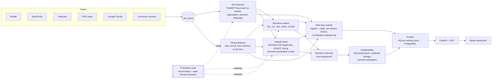

# Diverge: architecture and methodology

## Pipeline

| Stage | Package | Notes |
|---|---|---|
| Ingest | `scrapers/` | Public endpoints only, robots.txt checks, rate limits, stable-id de-duplication, 90-day retention. |
| Features | `features/` | Sentiment uses `models/finbert-tweets` when trained, else `ProsusAI/finbert`, else a keyword lexicon (offline). |
| Indices | `indices/` | Every index returns a value **or `None`**. No synthetic floors or proxy fallbacks. |
| Integrity | `integrity/` | Coordination probability from a logistic model trained by `evaluation/coordination_benchmark.py`. |
| Aggregation | `aggregation/` | "Narrative intensity": how strong the conversation is, *not* its direction. CIRG/CLI can only pull it down; low trust dampens toward neutral. |
| Outlook | `outlook/` | Next-day P(up) and expected move from the same feature code used in training (`outlook/features.py`). Explained by per-feature contributions, shrunk toward 50/50 when coordination risk is high (×0.5 low trust, ×0.75 moderate). |
| Publish | `publish.py` | Upserts new rows from the worker's SQLite store into the API's PostgreSQL. |
| Explainability | `explainability/` | Per-post contribution traces and window-to-window narrative evolution. |
| Serving | `api/`, `frontend/` | FastAPI (OpenAPI contract in `docs/openapi.json`), Alembic migrations, React + Vite. |
| Evaluation | `evaluation/` | Reproduces every number in `reports/RESULTS.md`. |

## Index definitions and validation status

| Index | Definition | Status |
|---|---|---|
| **Rn**: narrative reproduction number | Each account's first mention of a ticker is an "onset". R is estimated with the renewal-equation method of Cori et al. (2013): `I_t ~ Poisson(R * sum_s I_{t-s} w_s)` with a discretised gamma serial interval (mean 1.5 d, sd 1 d), Gamma(1, 5) prior, 7-day window. Reports the posterior mean and 95% credible interval. | Unit test: recovers the true R inside the 95% CrI in ≥ 85% of simulated epidemics. Used as a backtest feature. |
| **CLI**: capitulation language index | Share of posts in the window flagged by the capitulation lexicon. | Lexicon-based; used as a backtest feature. A trained classifier is future work. |
| **VDI**: vernacular divergence | `Z(English sentiment) − Z(Hinglish sentiment)` against the pooled window distribution; needs ≥ 20 posts per language. | Often `None` because Hinglish volume is the bottleneck. |
| **CIRG**: consumer-investor rating gap | `Z(investor sentiment) − Z(consumer review sentiment)`. | Only defined for consumer-facing companies. |
| **CASSI**: cross-asset spillover | Diebold-Yilmaz-style spillover: share of a ticker's 5-step forecast-error variance (VAR on daily sentiment) explained by other tickers. Needs ≥ 30 complete days. | Returns `None` if the VAR can't be estimated. |
| **Coordination score** | `100 × P(coordinated)` from logistic regression on KS-vs-Poisson, ACF peak, onset dispersion, cross-account near-duplicate share, sentiment variance, news flag, volume. | Benchmarked against injected campaigns; see `reports/RESULTS.md`. |

## Evaluation design

1. **Sentiment.** Public labelled finance tweets (`zeroshot/twitter-financial-news-sentiment`). The official validation split is the test set. Fine-tuning model selection uses a 10% split of *train*.
2. **Coordination.** No public labelled dataset of stock-promotion campaigns exists. So campaigns with known ground truth are injected into simulated organic traffic. The simulation includes hard negatives (news bursts with shared headlines), and post volume is matched across classes so volume alone can't reveal the label. The original hand-weighted score is kept as the baseline.
3. **Next-day outlook.** `train_outlook.py` uses the same walk-forward protocol and records accuracy vs the always-up baseline, calibration, accuracy per call strength ("leans" / "slight lean" / no call) and move-size precision. These are served by `/outlook/model` and shown next to every prediction.
4. **Predictive value.** Daily features from ~1.7M tweets (2015-2019) predict next-day |return| and excess-return direction. Expanding-window walk-forward by year; price-only baselines (HAR volatility, momentum). Diebold-Mariano test on forecast errors. Synthetic-data tests show that the harness detects a planted signal and does **not** find one in pure noise, which checks for look-ahead leakage.

## Known limitations

- The coordination detector's training data is simulated. Real-world precision has to be confirmed on hand-labelled windows. `fpr_on_news_bursts` in the results is the main failure mode.
- Sarcasm and capitulation detection are rule-based heuristics.
- The tweet backtest covers 5 US mega-caps. Results may not transfer to the Indian tickers the live scrapers track until enough history has been collected (`--source db`).
- Direction prediction for liquid large caps is near chance; the project does not claim tradeable alpha. The outlook shows its historical accuracy next to every call for this reason.
- The outlook model is trained on US large caps and applied live to NSE and US tickers, so live accuracy can differ from the recorded track record.
- Reddit's public JSON/RSS endpoints currently answer unauthenticated requests with HTTP 403/429, so live posts come mainly from StockTwits, Telegram, RSS news and Google Trends. The scraper respects these responses and does not work around them.
- The tweet dataset ends on 2019-12-31, so the 2020 test days in the backtest (2-8 January) carry no social data. Permutation importance is therefore measured on the last full test year (2019, recorded as `importance_year` in `reports/backtest.json`), not on those few days.
- The API latency in `reports/RESULTS.md` was measured on a Windows laptop against the local SQLite store, not the production PostgreSQL database.
